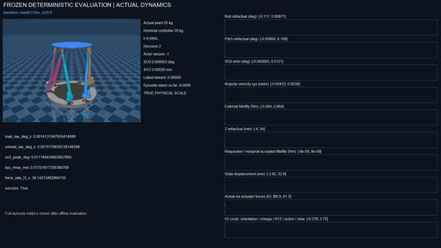
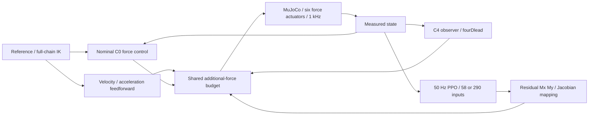

# Stewart Parallel Robot: Model-Based Control and Residual Reinforcement Learning

**MuJoCo-Based Stewart Platform Simulation, Disturbance Rejection, and Adaptive Residual PPO Control**

[中文说明](README_zh-CN.md) · [Architecture](docs/PROJECT_STRUCTURE.md) · [Research summary](docs/78_Stewart项目全阶段研究总结.md)

## Project overview

A 6-DoF closed-chain Stewart platform research system combining full-chain kinematics, model-based force control, disturbance observers and bounded residual PPO under unknown payload mass. Six leg force actuators execute actual MuJoCo dynamics.



## Key features and system architecture

Full-chain IK and finite-difference-validated Jacobians; 1 kHz physics and traditional control; C0, causal C4 observer, fourDlead and FF-VA feedforward; 50 mm vertical motion and active Roll/Pitch; physical step torque disturbances; reset-time mass/inertia randomization; multi-seed PPO and complete physical recording.



## Reinforcement learning

Gymnasium with Stable-Baselines3 PPO. Current-state observations have 58 causal features. Five frames form 290 inputs at 20 ms spacing, spanning 80 ms. Both actors request two residual moments, Mx/My, each bounded to ±0.05 N·m. Both share the traditional controller's ±5 N additional force per leg, 20 N/s additional-force slew, and native ±400 N actuator limit. Each 50 Hz action executes 20 physical steps. Reward V2 combines SO(3), angular velocity, XYZ, residual magnitude and slew costs plus a safety-failure penalty. Hidden mass, future disturbance timing and internal drive state are excluded from policy input.

## Experiments and results

Phase 2C-9B completed six runs across seeds 42, 123 and 2026, each with 32,768 decisions. Total formal interaction was 196,608 decisions and 3,932,160 MuJoCo integration steps. All 72 final closed-loop evaluations completed. Results below are independently regrouped from the archived per-trial CSV. PPO means average eight final tasks per seed, with all three seeds retained. Traditional methods ran eight tasks each.

| Method | Load IAE (deg·s) | Unload IAE (deg·s) | SO(3) peak (deg) |
|---|---:|---:|---:|
| baseline | 0.008269 | 0.001734 | 0.015667 |
| classical50 | 0.008199 | 0.001707 | 0.015556 |
| adaptive | 0.008143 | 0.001712 | 0.015504 |
| single_frame | 0.007736 | 0.001922 | 0.014778 |
| history_5frame | 0.008137 | 0.001715 | 0.015426 |

History PPO reduced mean unload IAE by 10.75% relative to single-frame PPO, while increasing mean load IAE by 5.18%. It did not meet the cross-seed, cross-task benefit criterion or establish superiority over classical adaptive control. Final stage decision: **NEGATIVE**, with engineering training completed. No statistical-significance claim is made.

Source results: [per-trial evaluation](results/phase2c9b_generalization.csv), [training ledger](results/phase2c9b_training_summary.csv), [acceptance report](docs/94_Phase2C9B最终验收报告.md).

## Installation and quick start

Validated local interpreter: Python 3.11.17 on Windows. Actual dependency versions are pinned in requirements.txt. The six terminal policy checkpoints are included. Run setup_portfolio.py after cloning to resolve portable metadata paths. Original snapshot paths are represented as __PROJECT_ROOT__ until this command runs.

```powershell
conda create -n stewart_portfolio python=3.11 -y
conda activate stewart_portfolio
python -m pip install torch==2.15.0 --index-url https://download.pytorch.org/whl/cpu
python -m pip install -r requirements.txt
python scripts/setup_portfolio.py
python scripts/view_stewart.py --viewer
python scripts/demo_home.py --seconds 1 --timestep 0.001
python scripts/view_phase2c9b_policy.py --method history_5frame --seed 42 --task Final_m21.5_6
python scripts/portfolio_smoke.py
```

## Demonstrations

- [Unknown mass / frozen baseline, 32 seconds](assets/videos/stewart_phase2c9b_unknown_mass.mp4)
- [Actual stochastic history-PPO training, 60 seconds](assets/videos/stewart_phase2c9b_history_training.mp4)
- [Frozen single-frame/history comparison, all seeds, 126 seconds](assets/videos/stewart_phase2c9b_single_vs_history.mp4)

The original RGB recordings were captured during physical integration; compiled videos distinguish stochastic training and frozen evaluation. Derived GIFs are display excerpts of those recordings.

## Reproduction scope

Core source, configurations, six final policies, geometric reference caches and final admission metadata are included. Raw 1 ms journals, rollout arrays, intermediate checkpoints, complete historical test fixtures and TensorBoard events remain local. Archived experiment tests require their omitted datasets. Run the lightweight smoke command for the distribution's current model, policy and dynamics checks.

PPO entry point: python scripts/train_phase2c9b_ppo.py --help. The archived training script uses protected fixed output namespaces; use an independently named run/model namespace for retraining. Full historical retraining was not repeated for this release. TensorBoard events, when available locally, can be opened with python -m tensorboard.main --logdir results/runs/phase2c9b_20261112_v1/training.

## Limitations and provenance

Validation is in simulation. Mass is fixed per episode, with density-scaled inertia. Payload attachment during motion, hardware deployment and hydraulic identification remain unverified. Higher masses consume shared control budget. Collision checks cover partial geometry proxies. History PPO has no established stable advantage. The historical Phase 0 test forbidding Torch/SB3 conflicts with the later learning environment; original failures are retained in the report.

Model attribution and applicable licenses are in THIRD_PARTY_NOTICES.md. Historical READMEs inside third-party directories retain their upstream context.
