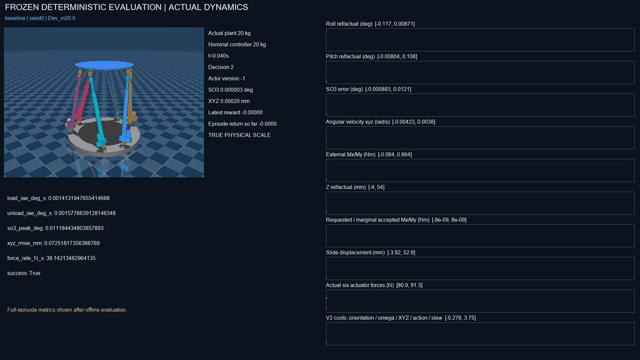
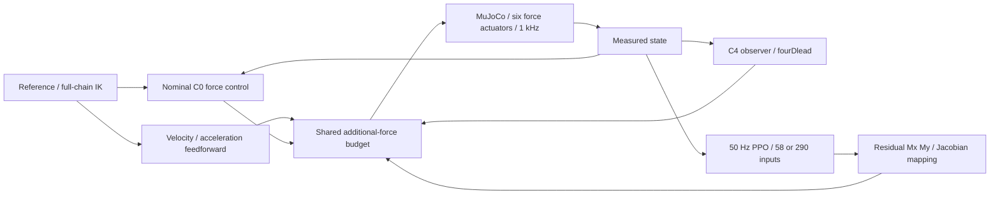

# Stewart并联机器人：模型控制与残差强化学习

六自由度闭链MuJoCo系统，涵盖六支链力控制、实际运动链IK/Jacobian、C4因果观测、fourDlead、FF-VA以及未知负载质量下的历史反馈PPO。



## 系统结构



## 强化学习与控制约束

物理与传统控制1000 Hz，PPO 50 Hz，每决策20个物理步。单帧58维，五帧290维，首尾跨度80 ms。二维Mx/My请求每轴±0.05 N·m，共享相对C0附加力每支链±5 N、20 N/s，原生±400 N。沿用Reward-V2，质量与惯量仅在reset时改变，名义控制器保持20 kg。历史缓冲按回合清空，Actor使用因果反馈。

## 实际实验结果

六组训练、三个种子，每组32768决策，共196608决策与3932160物理步。最终72次闭环全部完成。下表从原始逐任务评价CSV重新分组计算，传统方法各8任务，PPO各3种子×8任务。

| Method | Load IAE (deg·s) | Unload IAE (deg·s) | SO(3) peak (deg) |
|---|---:|---:|---:|
| baseline | 0.008269 | 0.001734 | 0.015667 |
| classical50 | 0.008199 | 0.001707 | 0.015556 |
| adaptive | 0.008143 | 0.001712 | 0.015504 |
| single_frame | 0.007736 | 0.001922 | 0.014778 |
| history_5frame | 0.008137 | 0.001715 | 0.015426 |

五帧历史相对单帧卸载IAE降低10.75%，加载IAE增加5.18%。历史策略未达到跨种子、跨任务优势标准，未证明超过经典适应控制。阶段结论NEGATIVE，工程训练已完成。报告保留全部种子与失败测试。

## 安装与运行

已验证本机Python 3.11.17。requirements.txt来自实际环境，六个最终模型及必要几何缓存随仓库提供。克隆后先运行setup_portfolio.py解析可移植路径。

```powershell
conda create -n stewart_portfolio python=3.11 -y
conda activate stewart_portfolio
python -m pip install torch==2.15.0 --index-url https://download.pytorch.org/whl/cpu
python -m pip install -r requirements.txt
python scripts/setup_portfolio.py
python scripts/view_stewart.py --viewer
python scripts/demo_home.py --seconds 1 --timestep 0.001
python scripts/view_phase2c9b_policy.py --method history_5frame --seed 42 --task Final_m21.5_6
python scripts/portfolio_smoke.py
```

## 演示与复现范围

[未知质量基线](assets/videos/stewart_phase2c9b_unknown_mass.mp4) · [实际随机训练](assets/videos/stewart_phase2c9b_history_training.mp4) · [全部种子冻结策略对比](assets/videos/stewart_phase2c9b_single_vs_history.mp4)

完整src/scripts/configs/tests保持原目录关系。原始1 ms日志、完整历史测试数据、rollout、TensorBoard事件及中间权重保留本地。轻量验收用portfolio_smoke.py；历史研究测试需补齐对应归档。训练入口--help可查看参数，重新训练需独立命名空间，已有固定运行目录受保护。发布任务未重跑长训练。

## 局限

目前为仿真验证。质量在episode开始时固定，未实现运动中挂载适应、实机控制或真实液压辨识。高质量工况存在预算约束，几何代理覆盖有限。原Phase 0禁用学习包的测试与后续环境冲突，原始失败在报告中保留。模型来源及许可见THIRD_PARTY_NOTICES.md。

[全阶段总结](docs/78_Stewart项目全阶段研究总结.md) · [最终验收](docs/94_Phase2C9B最终验收报告.md)
