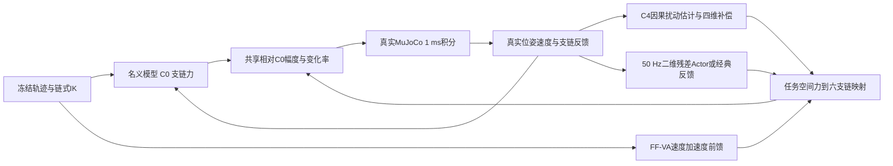

# Stewart 控制架构与算法演进

C0用名义重力与反馈生成六支链基准。C4-Observer利用状态响应和已知已施加命令估计外载，fourDlead以带动态补偿的任务空间项补充基线，FF-VA使用参考速度与加速度。50Hz经典姿态反馈以姿态旋转向量和角速度误差产生Mx/My，Phase 8使用25和1的PD系数。Residual PPO在相同二维通道输出每轴±0.05 N·m。传统与学习补偿共同服从每支链相对C0±5 N及20 N/s，实际执行器原生限幅±400 N。实际驱动力变化率与相对C0限速口径不同。

实现证据见 src/visualization/owner.py、src/workspace/dynamic_attitude_study.py、src/rl/stewart_dynamic_attitude_env.py 和 scripts/evaluate_phase2c8.py。

README中的“没有PPO”和未安装学习包是Phase 0快照。2C-8运行归档及checkpoint证实后续安装并训练；旧Phase 0环境断言因此在2C-8回归失败。旧2C-7阶段切换时VecEnv seed覆盖恢复状态，2C-8用独立任务RNG并完成阶段边界逐位复现。

