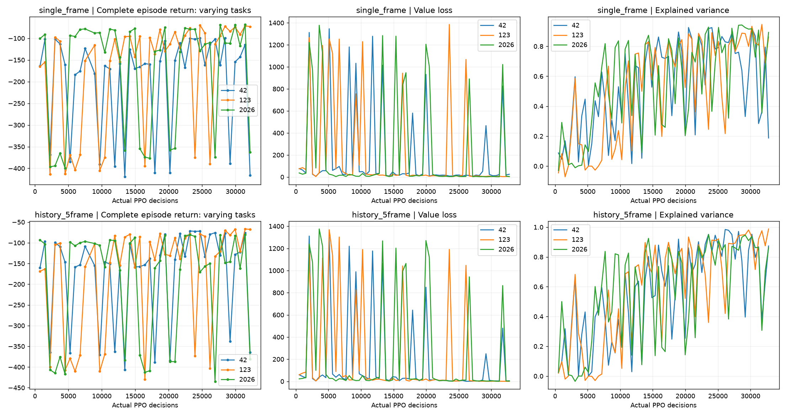
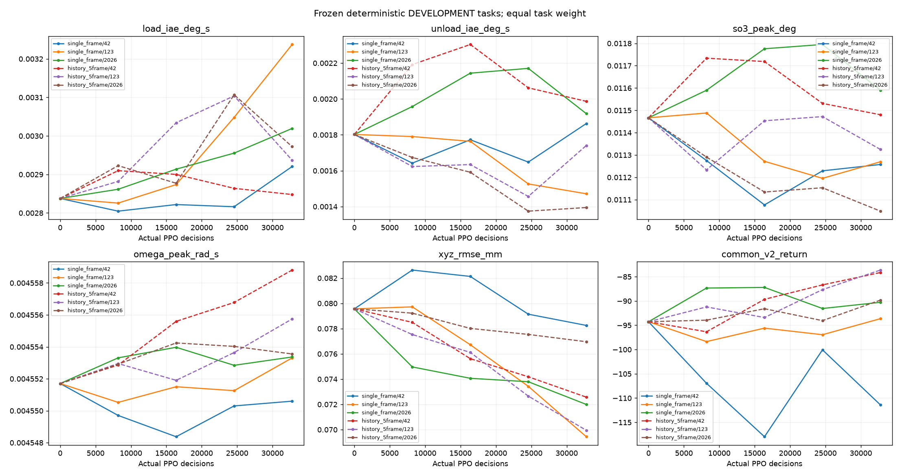

# Phase 2C-9B 真实PPO训练与学习曲线

日期2026-11-12，Asia/Shanghai。独立归档 `__PROJECT_ROOT__\results\runs\phase2c9b_20261112_v1`。数值从实际CSV/JSON/NPZ重算。

| method | seed | decisions | physics | complete | fragments | failures | wall_s | ppo_updates | adam_steps |
| --- | --- | --- | --- | --- | --- | --- | --- | --- | --- |
| history_5frame | 42 | 32768 | 655360 | 42 | 2 | 0 | 3565.515 | 64 | 5013 |
| history_5frame | 123 | 32768 | 655360 | 42 | 2 | 0 | 3535.053 | 64 | 5082 |
| history_5frame | 2026 | 32768 | 655360 | 42 | 2 | 0 | 3532.015 | 64 | 5120 |
| single_frame | 42 | 32768 | 655360 | 42 | 2 | 0 | 3560.418 | 64 | 5120 |
| single_frame | 123 | 32768 | 655360 | 42 | 2 | 0 | 3538.838 | 64 | 5120 |
| single_frame | 2026 | 32768 | 655360 | 42 | 2 | 0 | 3533.351 | 64 | 5120 |

正式合计196608决策、3932160物理步、384次PPO更新、30575次Adam。完整回合252，预算片段12，保护失败0。各回合任务、质量、原始动作、实际接受补偿与1 ms状态保留。预算片段不计作完整成功或失败。

两方法优化器配置与最大epoch预算相同。原target_kl=0.03保留，部分更新触发既有KL提前退出，因此实际Adam步数不是每次都达到80；表中记录真实执行量，没有把最大预算当作实际优化次数。

8192决策Pilot结束时，当前未结束回合按预算片段归档；共同门禁通过后，两方法都以新回合reset续训，并恢复优化器、全局随机状态及独立任务采样器。阶段内跨512步rollout的回合不被截断。这里是匹配的显式阶段边界协议，不称为任意回合中途无缝继续。

Pilot判定原件如下。

`{'passed': True, 'details': [{'method': 'single_frame', 'seed': 42, 'guard': True, 'learning_evidence': True, 'ratios': {'load_iae_deg_s': 0.9883790026933297, 'unload_iae_deg_s': 0.9113285240754591, 'xyz_rmse_mm': 1.0386188778521412}}, {'method': 'single_frame', 'seed': 123, 'guard': True, 'learning_evidence': True, 'ratios': {'load_iae_deg_s': 0.9957595967059029, 'unload_iae_deg_s': 0.9935531853323224, 'xyz_rmse_mm': 1.0019784527350712}}, {'method': 'single_frame', 'seed': 2026, 'guard': True, 'learning_evidence': True, 'ratios': {'load_iae_deg_s': 1.008407149172434, 'unload_iae_deg_s': 1.086425746786533, 'xyz_rmse_mm': 0.9421804345385848}}, {'method': 'history_5frame', 'seed': 42, 'guard': True, 'learning_evidence': False, 'ratios': {'load_iae_deg_s': 1.0254436283990933, 'unload_iae_deg_s': 1.216305793265024, 'xyz_rmse_mm': 0.9865337690877691}}, {'method': 'history_5frame', 'seed': 123, 'guard': True, 'learning_evidence': True, 'ratios': {'load_iae_deg_s': 1.015590199374381, 'unload_iae_deg_s': 0.9007604810015608, 'xyz_rmse_mm': 0.9744380610349122}}, {'method': 'history_5frame', 'seed': 2026, 'guard': True, 'learning_evidence': True, 'ratios': {'load_iae_deg_s': 1.0300353988978588, 'unload_iae_deg_s': 0.9287611752597368, 'xyz_rmse_mm': 0.9957169572692817}}], 'family_learning': {'single_frame': True, 'history_5frame': True}, 'rule': 'all six finite runs and real actor/critic updates; no protection; per-seed development mean IAE/XYZ <=150% initial; at least one development IAE or common return improves in each method family', 'no_final_policy_used': True}`

最终共同预算为32768。每个种子纳入全部统计，终端模型统一选择，没有用最终测试挑模型。0/8192以及实际执行到的16384/24576/32768均保存；未运行的阶段不会创建checkpoint。原生模型SHA见 final_selection.json。

训练回报因质量/任务变化而不能视为相同任务性能曲线。固定开发集在相同checkpoint上确定性执行，逐个任务等权。全部正式奖励分量逐物理步复算，所有rollout GAE和bootstrap独立核验。Value Loss大小与物理控制收益分开解释。

| method | seed | value_loss_max | explained_variance_last | target_std_max | bias_last |
| --- | --- | --- | --- | --- | --- |
| history_5frame | 42 | 1311.003 | 0.8735519 | 32.3598 | -0.5712933 |
| history_5frame | 123 | 1368.542 | 0.9878243 | 37.00303 | -1.011103 |
| history_5frame | 2026 | 1375.188 | 0.8607839 | 37.20444 | 0.002211317 |
| single_frame | 42 | 1346.288 | 0.1876978 | 31.59161 | 0.8482094 |
| single_frame | 123 | 1385.548 | 0.8620396 | 37.30278 | -0.7575876 |
| single_frame | 2026 | 1377.907 | 0.8932391 | 36.35746 | 0.6453166 |

上述Value Loss是SB3记录的实际优化批次损失，不能单凭最大值判断发散；应结合不同任务组成、价值目标的尺度、预测偏差和Explained Variance。每次更新的目标/预测/优势5%、50%、95%分位数和实际任务组成保存在update_events.csv。按SB3 float32运算独立复算全部GAE的最大绝对误差为0。网络更新和价值拟合不等于闭环控制优于经典补偿，最终按物理IAE及代价护栏判断。
