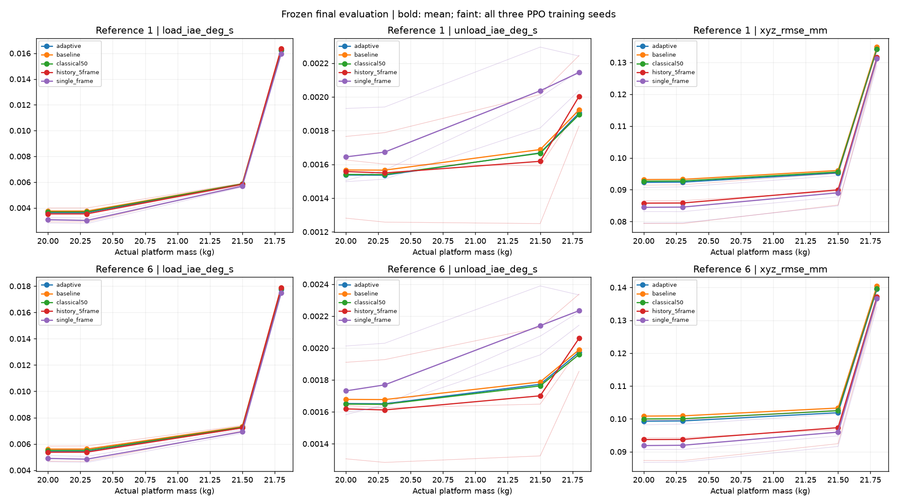

# Phase 2C-9B 经典控制与未知质量泛化评价

日期2026-11-12，Asia/Shanghai。独立归档 `__PROJECT_ROOT__\results\runs\phase2c9b_20261112_v1`。数值从实际CSV/JSON/NPZ重算。

最终8个任务×9策略，共72次真实闭环，完成72次。每任务传统控制3个方法各运行一次，两个PPO方法各3个独立训练种子。评价参考、质量、外载和控制限制配对；独立配置训练前冻结，基线安全预检已执行，不能称完全未观察过的物理场景。未见质量20.3、21.5、21.8 kg，20 kg作名义回归。参考几何缓存沿用已审核资产，最终参考/外载组合和时序与训练不同。

全部测试质量位于训练质量范围内，是未见数值的插值评价。质量在reset时设置并整回合固定，外扰在运行中突加与卸载。本轮恢复时间对应未知固定质量下的外力矩事件，不能解释为回合中质量突然改变后的辨识或适应速度。

经典适应补偿在开发任务选定 `{'kp': 25.0, 'kd': 1.0, 'ki': 30.0, 'leak': 1.0, 'imax': 0.025}`。候选积分增益0、10、30，按加载+卸载IAE以及XYZ非劣护栏选择。积分变化在50 Hz处理，控制命令仍经原物理预算器。未读取隐藏质量。

各方法均值（PPO再对三个种子等权，传统不重复成三次）如下。

| method | load_iae_deg_s | unload_iae_deg_s | so3_peak_deg | omega_peak_rad_s | z_rmse_mm | xyz_rmse_mm | xy_peak_mm | force_rate_N_s | force_squared_integral_N2_s | trials | complete_success |
| --- | --- | --- | --- | --- | --- | --- | --- | --- | --- | --- | --- |
| adaptive | 0.008142953 | 0.001711776 | 0.01550442 | 0.004548312 | 0.02064156 | 0.106775 | 0.2310752 | 55.77894 | 654277.2 | 8 | 8 |
| baseline | 0.00826866 | 0.00173431 | 0.01566663 | 0.004549443 | 0.02064354 | 0.1078529 | 0.2333898 | 55.77888 | 654277.2 | 8 | 8 |
| classical50 | 0.008198825 | 0.001707345 | 0.01555567 | 0.004549105 | 0.02064306 | 0.1071818 | 0.2318699 | 55.77899 | 654277.2 | 8 | 8 |
| history_5frame | 0.008137195 | 0.001715035 | 0.01542578 | 0.004546252 | 0.02064523 | 0.1018865 | 0.2267767 | 55.81502 | 654276.5 | 24 | 24 |
| single_frame | 0.00773639 | 0.001921659 | 0.01477843 | 0.004550909 | 0.020625 | 0.1007173 | 0.2239247 | 55.77954 | 654277.8 | 24 | 24 |

逐训练种子平均如下。

| method | seed | load_iae_deg_s | unload_iae_deg_s | so3_peak_deg | omega_peak_rad_s | z_rmse_mm | xyz_rmse_mm | xy_peak_mm | force_rate_N_s | force_squared_integral_N2_s |
| --- | --- | --- | --- | --- | --- | --- | --- | --- | --- | --- |
| history_5frame | 42 | 0.008238244 | 0.001422692 | 0.0155178 | 0.004546069 | 0.02065834 | 0.101875 | 0.2282479 | 55.81336 | 654275.6 |
| history_5frame | 123 | 0.007739296 | 0.001707648 | 0.01507648 | 0.004545905 | 0.02060781 | 0.09711437 | 0.2203666 | 55.82477 | 654276.6 |
| history_5frame | 2026 | 0.008434044 | 0.002014763 | 0.01568306 | 0.004546783 | 0.02066955 | 0.1066703 | 0.2317156 | 55.80693 | 654277.3 |
| single_frame | 42 | 0.007872059 | 0.002146787 | 0.01499971 | 0.004552721 | 0.02064506 | 0.1060506 | 0.2285033 | 55.77623 | 654277.8 |
| single_frame | 123 | 0.007578793 | 0.001843893 | 0.01446753 | 0.004551038 | 0.02060891 | 0.0965478 | 0.219584 | 55.77641 | 654278 |
| single_frame | 2026 | 0.007758317 | 0.001774298 | 0.01486804 | 0.004548969 | 0.02062103 | 0.09955354 | 0.2236867 | 55.78599 | 654277.6 |

历史策略配对改善百分比，正值改善、负值退化。

| seed | task_id | mass_kg | comparator | load_improvement_pct | history_load_iae_deg_s | comparator_load_iae_deg_s | history_unload_iae_deg_s | comparator_unload_iae_deg_s | load_absolute_reduction_deg_s | unload_absolute_reduction_deg_s | unload_improvement_pct | all_guards | safe_complete | both_iae_improve | unload_recovery_comparable | unload_recovery_delta_ms |
| --- | --- | --- | --- | --- | --- | --- | --- | --- | --- | --- | --- | --- | --- | --- | --- | --- |
| 123 | Final_m20.0_1 | 20 | single_frame | -3.19458 | 0.002917601 | 0.002827281 | 0.001626031 | 0.001504267 | -9.031977e-05 | -0.0001217643 | -8.094597 | True | True | False | True | 10 |
| 123 | Final_m20.0_1 | 20 | adaptive | 19.68845 | 0.002917601 | 0.003632853 | 0.001626031 | 0.001536696 | 0.0007152525 | -8.93353e-05 | -5.813466 | True | True | False | True | 3 |
| 2026 | Final_m20.0_1 | 20 | single_frame | -27.10243 | 0.003988495 | 0.003138016 | 0.001765553 | 0.001497299 | -0.0008504787 | -0.0002682541 | -17.91587 | False | True | False | True | 0 |
| 2026 | Final_m20.0_1 | 20 | adaptive | -9.789599 | 0.003988495 | 0.003632853 | 0.001765553 | 0.001536696 | -0.0003556418 | -0.0002288567 | -14.89278 | True | True | False | True | -2 |
| 42 | Final_m20.0_1 | 20 | single_frame | -13.32414 | 0.003686232 | 0.003252822 | 0.001281167 | 0.001931468 | -0.0004334107 | 0.000650301 | 33.66874 | True | True | False | True | -13 |
| 42 | Final_m20.0_1 | 20 | adaptive | -1.469341 | 0.003686232 | 0.003632853 | 0.001281167 | 0.001536696 | -5.337902e-05 | 0.0002555289 | 16.62846 | True | True | False | True | -10 |
| 123 | Final_m20.0_6 | 20 | single_frame | -1.095399 | 0.004692807 | 0.004641959 | 0.00163986 | 0.001582368 | -5.084799e-05 | -5.749152e-05 | -3.633259 | True | True | False | True | 8 |
| 123 | Final_m20.0_6 | 20 | adaptive | 13.28592 | 0.004692807 | 0.005411817 | 0.00163986 | 0.001652145 | 0.0007190095 | 1.228533e-05 | 0.743599 | True | True | False | True | 2 |
| 2026 | Final_m20.0_6 | 20 | single_frame | -18.17249 | 0.005837806 | 0.004940072 | 0.001910463 | 0.001599004 | -0.0008977339 | -0.0003114583 | -19.47826 | True | True | False | True | 0 |
| 2026 | Final_m20.0_6 | 20 | adaptive | -7.871459 | 0.005837806 | 0.005411817 | 0.001910463 | 0.001652145 | -0.000425989 | -0.0002583177 | -15.6353 | True | True | False | True | -1 |
| 42 | Final_m20.0_6 | 20 | single_frame | -9.26515 | 0.005580772 | 0.00510755 | 0.001305597 | 0.002012873 | -0.0004732222 | 0.0007072763 | 35.13764 | True | True | False | True | -13 |
| 42 | Final_m20.0_6 | 20 | adaptive | -3.121966 | 0.005580772 | 0.005411817 | 0.001305597 | 0.001652145 | -0.0001689551 | 0.0003465477 | 20.97562 | True | True | False | True | -10 |
| 123 | Final_m20.3_1 | 20.3 | single_frame | -4.3402 | 0.002900695 | 0.002780036 | 0.001601587 | 0.001565843 | -0.0001206591 | -3.574382e-05 | -2.28272 | True | True | False | True | 8 |
| 123 | Final_m20.3_1 | 20.3 | adaptive | 20.15294 | 0.002900695 | 0.003632814 | 0.001601587 | 0.001535827 | 0.000732119 | -6.576025e-05 | -4.281749 | True | True | False | True | 3 |
| 2026 | Final_m20.3_1 | 20.3 | single_frame | -30.41709 | 0.003994577 | 0.003062925 | 0.00178816 | 0.00151261 | -0.0009316526 | -0.0002755503 | -18.21688 | False | True | False | True | -1 |
| 2026 | Final_m20.3_1 | 20.3 | adaptive | -9.958204 | 0.003994577 | 0.003632814 | 0.00178816 | 0.001535827 | -0.000361763 | -0.000252333 | -16.42978 | True | True | False | True | -2 |
| 42 | Final_m20.3_1 | 20.3 | single_frame | -15.01411 | 0.003701336 | 0.003218158 | 0.00125776 | 0.001940112 | -0.0004831778 | 0.0006823529 | 35.17079 | True | True | False | True | -14 |
| 42 | Final_m20.3_1 | 20.3 | adaptive | -1.886199 | 0.003701336 | 0.003632814 | 0.00125776 | 0.001535827 | -6.85221e-05 | 0.0002780674 | 18.10539 | True | True | False | True | -10 |
| 123 | Final_m20.3_6 | 20.3 | single_frame | -2.010997 | 0.004687786 | 0.004595373 | 0.001625286 | 0.001645581 | -9.241282e-05 | 2.029568e-05 | 1.233344 | True | True | False | True | 7 |
| 123 | Final_m20.3_6 | 20.3 | adaptive | 13.4123 | 0.004687786 | 0.005413916 | 0.001625286 | 0.001650807 | 0.0007261305 | 2.552178e-05 | 1.546018 | True | True | True | True | 2 |
| 2026 | Final_m20.3_6 | 20.3 | single_frame | -20.0698 | 0.00584453 | 0.004867611 | 0.001927533 | 0.001631811 | -0.0009769198 | -0.0002957226 | -18.12236 | True | True | False | True | 0 |
| 2026 | Final_m20.3_6 | 20.3 | adaptive | -7.953836 | 0.00584453 | 0.005413916 | 0.001927533 | 0.001650807 | -0.000430614 | -0.0002767258 | -16.76306 | True | True | False | True | -1 |
| 42 | Final_m20.3_6 | 20.3 | single_frame | -10.60701 | 0.005594444 | 0.005057947 | 0.001283034 | 0.002030067 | -0.0005364969 | 0.0007470329 | 36.79844 | True | True | False | True | -14 |
| 42 | Final_m20.3_6 | 20.3 | adaptive | -3.33451 | 0.005594444 | 0.005413916 | 0.001283034 | 0.001650807 | -0.0001805276 | 0.0003677735 | 22.2784 | True | True | False | True | -10 |
| 123 | Final_m21.5_1 | 21.5 | single_frame | -2.60694 | 0.00575611 | 0.005609865 | 0.001591486 | 0.001998055 | -0.0001462458 | 0.0004065691 | 20.34825 | True | True | False | True | 4 |
| 123 | Final_m21.5_1 | 21.5 | adaptive | 1.473709 | 0.00575611 | 0.005842207 | 0.001591486 | 0.001667994 | 8.609715e-05 | 7.650843e-05 | 4.586853 | True | True | True | True | 3 |
| 2026 | Final_m21.5_1 | 21.5 | single_frame | -4.658104 | 0.005905252 | 0.005642422 | 0.002014118 | 0.00181594 | -0.0002628299 | -0.000198178 | -10.91324 | True | True | False | True | -5 |
| 2026 | Final_m21.5_1 | 21.5 | adaptive | -1.079122 | 0.005905252 | 0.005842207 | 0.002014118 | 0.001667994 | -6.304454e-05 | -0.0003461241 | -20.75092 | True | True | False | True | -3 |
| 42 | Final_m21.5_1 | 21.5 | single_frame | 0.005624445 | 0.005807726 | 0.005808052 | 0.001249039 | 0.002295262 | 3.266707e-07 | 0.001046223 | 45.58185 | True | True | False | True | -19 |
| 42 | Final_m21.5_1 | 21.5 | adaptive | 0.5902204 | 0.005807726 | 0.005842207 | 0.001249039 | 0.001667994 | 3.44819e-05 | 0.0004189548 | 25.11728 | True | True | False | True | -11 |
| 123 | Final_m21.5_6 | 21.5 | single_frame | -2.741143 | 0.006996961 | 0.006810282 | 0.001648433 | 0.00207454 | -0.0001866795 | 0.000426107 | 20.53983 | True | True | False | True | 4 |
| 123 | Final_m21.5_6 | 21.5 | adaptive | 3.229727 | 0.006996961 | 0.007230486 | 0.001648433 | 0.001772693 | 0.000233525 | 0.0001242608 | 7.009716 | True | True | True | True | 3 |
| 2026 | Final_m21.5_6 | 21.5 | single_frame | -7.446415 | 0.007407579 | 0.006894207 | 0.002129309 | 0.001956969 | -0.0005133713 | -0.0001723394 | -8.806443 | True | True | False | True | -4 |
| 2026 | Final_m21.5_6 | 21.5 | adaptive | -2.449247 | 0.007407579 | 0.007230486 | 0.002129309 | 0.001772693 | -0.0001770925 | -0.0003566151 | -20.11713 | True | True | False | True | -1 |
| 42 | Final_m21.5_6 | 21.5 | single_frame | -2.428885 | 0.007263688 | 0.007091445 | 0.001323836 | 0.002389326 | -0.0001722431 | 0.00106549 | 44.59373 | True | True | False | True | -17 |
| 42 | Final_m21.5_6 | 21.5 | adaptive | -0.459196 | 0.007263688 | 0.007230486 | 0.001323836 | 0.001772693 | -3.32021e-05 | 0.000448857 | 25.32062 | True | True | False | True | -9 |
| 123 | Final_m21.8_1 | 21.8 | single_frame | -1.814376 | 0.01623121 | 0.01594196 | 0.001937044 | 0.002154194 | -0.0002892471 | 0.0002171502 | 10.08035 | True | True | False | True | 7 |
| 123 | Final_m21.8_1 | 21.8 | adaptive | 0.04309707 | 0.01623121 | 0.01623821 | 0.001937044 | 0.001904498 | 6.99819e-06 | -3.254572e-05 | -1.708887 | True | True | False | True | 7 |
| 2026 | Final_m21.8_1 | 21.8 | single_frame | -2.928685 | 0.01648093 | 0.01601199 | 0.002245314 | 0.002037606 | -0.0004689406 | -0.0002077075 | -10.1937 | True | True | False | True | -4 |
| 2026 | Final_m21.8_1 | 21.8 | adaptive | -1.494754 | 0.01648093 | 0.01623821 | 0.002245314 | 0.001904498 | -0.0002427212 | -0.0003408158 | -17.89531 | True | True | False | True | 0 |
| 42 | Final_m21.8_1 | 21.8 | single_frame | -2.630873 | 0.01637026 | 0.01595062 | 0.001827126 | 0.002242254 | -0.0004196406 | 0.0004151274 | 18.51385 | True | True | False | True | -17 |
| 42 | Final_m21.8_1 | 21.8 | adaptive | -0.8132402 | 0.01637026 | 0.01623821 | 0.001827126 | 0.001904498 | -0.0001320556 | 7.73718e-05 | 4.062582 | True | True | False | True | -8 |
| 123 | Final_m21.8_6 | 21.8 | single_frame | -1.765489 | 0.0177312 | 0.01742359 | 0.001991457 | 0.002226293 | -0.0003076115 | 0.0002348359 | 10.54829 | True | True | False | True | 6 |
| 123 | Final_m21.8_6 | 21.8 | adaptive | 0.05705141 | 0.0177312 | 0.01774132 | 0.001991457 | 0.001973543 | 1.012167e-05 | -1.791378e-05 | -0.9076965 | True | True | False | True | 6 |
| 2026 | Final_m21.8_6 | 21.8 | single_frame | -2.877845 | 0.01801319 | 0.0175093 | 0.002337659 | 0.002143145 | -0.0005038904 | -0.0001945137 | -9.076085 | True | True | False | True | -4 |
| 2026 | Final_m21.8_6 | 21.8 | adaptive | -1.532401 | 0.01801319 | 0.01774132 | 0.002337659 | 0.001973543 | -0.0002718682 | -0.0003641151 | -18.44982 | True | True | False | True | 0 |
| 42 | Final_m21.8_6 | 21.8 | single_frame | -2.35343 | 0.01790149 | 0.01748988 | 0.001853979 | 0.002332936 | -0.0004116121 | 0.0004789572 | 20.53023 | True | True | False | True | -17 |
| 42 | Final_m21.8_6 | 21.8 | adaptive | -0.9027989 | 0.01790149 | 0.01774132 | 0.001853979 | 0.001973543 | -0.0001601684 | 0.0001195641 | 6.058348 | True | True | False | True | -8 |

SO(3)误差用旋转矩阵相对旋转的对数模长，加载/卸载各取事件后1000个1 ms样本。未完整覆盖窗口时明确记录截断；提前失败的低误差不计改善。XYZ_RMSE是三维误差范数均方根，力平方积分不等于能耗。恢复指标保留未越阈值与右删失状态，不强制写0秒。

卸载后0.01度阈值恢复状态统计如下。只有两个配对方法均为recovered时才计算恢复时间差，负毫秒代表历史策略更快；其余情况不排序，见 paired_effects.csv 的对应列。

| method | unload_recovery_0.01_status | trials |
| --- | --- | --- |
| adaptive | recovered | 8 |
| baseline | recovered | 8 |
| classical50 | recovered | 8 |
| history_5frame | recovered | 24 |
| single_frame | recovered | 24 |
